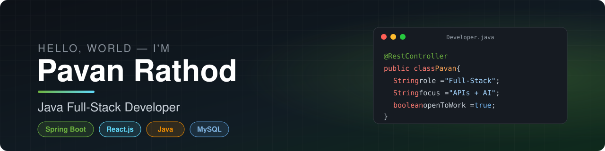

  

<h1 align="center">Hi, I'm Pavan Rathod 👋</h1>
<h3 align="center">Java Full-Stack Developer · Spring Boot · React.js</h3>

  

  
  
  
  

---

## 👨‍💻 About Me

I'm a final-year **B.Tech Information Technology** student at **Sandip Institute of Technology and Research Centre, Nashik** (2023–2027), currently working as a **Website Development Intern at Growmatiq**.

I like turning real-world requirements into clean, maintainable software: full-stack apps, secure REST APIs, and well-designed relational databases. My core stack is **Java, Spring Boot, React.js, and MySQL**.

- 💼 Website Development Intern @ **Growmatiq**
- ☕ Focused on Java, Spring Boot, REST APIs, and full-stack development
- 🗄️ Interested in backend engineering, database design, and application security
- 🤖 Exploring LLMs, RAG, and workflow automation
- 📫 Reach me at **rpavanr25@gmail.com**

---

## 🧰 Tech Stack

**Languages**

  
  
  
  
  
  

**Frameworks & Libraries**

  
  
  
  
  
  

**Databases, Cloud & Tools**

  
  
  
  
  
  

**Automation & Web Platforms**

  
  
  
  

Also working with: Spring Data JPA · REST API integration · LLMs · Prompt engineering · RAG · Embeddings · Vector databases · Semantic search · SEO · GEO (AI search optimization)

---

## 💼 Experience

### Website Development Intern — Growmatiq
*Remote · April 2026 – Present*

- Build and customize responsive client websites with **Shopify, HTML, CSS, and JavaScript**
- Work with themes, plugins, and third-party integrations
- Implement **SEO and GEO** strategies to improve visibility across search engines and AI-powered search
- Support prospect research and lead-generation workflows using CRM and sales-intelligence tools
- Collaborate with design and marketing teams on websites, automation, and digital campaigns

---

## 🚀 Featured Projects

<table>
  <tr>
    <td width="50%" valign="top">
      <h3>🛠️ ServiceHub</h3>
      
<b>Service booking platform</b> with separate customer, provider, and admin workflows.

      <ul>
        <li>Secure REST APIs with Spring Security</li>
        <li>Service search, provider availability & booking management</li>
        <li>Persistence with Spring Data JPA + MySQL</li>
        <li>Input validation & global exception handling</li>
      </ul>
      

        
        
        
        
      

      <a href="https://github.com/Pavanrr25/SERVICEHUB_REPO_NAME">🔗 View Repository</a>
    </td>
    <td width="50%" valign="top">
      <h3>🥛 Dairy Company Website</h3>
      
<b>Responsive company website</b> built for a clean experience on every screen size.

      <ul>
        <li>Responsive layouts for desktop, tablet & mobile</li>
        <li>User-friendly, accessible interface</li>
        <li>Interactive elements with vanilla JavaScript</li>
      </ul>
      

        
        
        
      

      <a href="https://github.com/Pavanrr25/DAIRY_REPO_NAME">🔗 View Repository</a>
    </td>
  </tr>
</table>

---

## 📊 GitHub Stats

  
  

  

---

## 🌱 Currently Exploring

- Advanced Java & Spring Boot application development
- Secure API design and backend architecture
- Database optimization and efficient SQL
- Automated testing and CI/CD deployment
- Practical AI integrations with LLMs, RAG, and vector databases
- Workflow automation with n8n

---

## 📜 Certifications

| Certification | Issuer | Date |
|---|---|---|
| Software Engineer Intern (Problem Solving, SQL) | HackerRank | Sep 2024 |
| Python (Basic) | HackerRank | Feb 2025 |

---

## 🤝 Let's Connect

I'm always happy to connect with developers, engineering teams, recruiters, and founders building meaningful products. **Open to internship and full-time opportunities.**

  
  
  

<i>Thanks for visiting! ⭐ Feel free to explore my repositories.</i>

